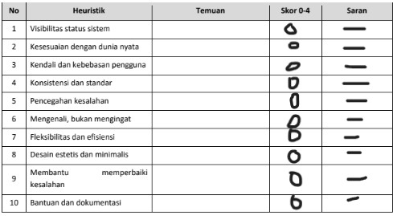
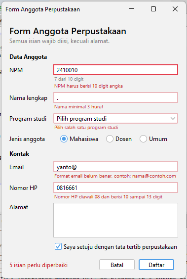
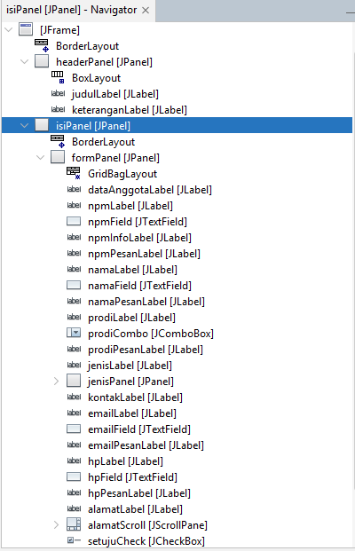

# P06 – Validasi Input dan Kegunaan

Nama / NPM : Febriawan Rezky

# Bagian F. Tugas yang Dikumpulkan

## 1. Tautan repository GitHub
`https://github.com/febrirezky/pbo2-2410010589`

## 2. Lembar peer review dari teman
Foto atau pindaian lembar yang diisi teman: 

Nama peninjau: Rahmat Ramadhan  Nama pemilik form: Febriawan Rezky

## 3. Tabel temuan, perbaikan, dan commit

| No | Temuan dari teman | Heuristik | Skor | Perbaikan yang saya lakukan | Commit |
| 1  |                   |           |  0   |             -               |   -    |
| 2  |                   |           |  0   |             -               |   -    |
| 3  |                   |           |  0   |             -               |   -    |

## 4. Tangkapan layar
- Form dengan pesan kesalahan: 
- Jendela Navigator yang memperlihatkan label pesan: 

## 5. Jawaban eksperimen Praktikum 4
1. **Mengetik huruf pada isian NPM.** Huruf tidak muncul di isian. Penyebabnya baris `evt.consume();` di dalam `if (!Character.isDigit(evt.getKeyChar()) || penuh)` pada `npmFieldKeyTyped`. Karakter yang bukan angka (atau ketikan ke-11) dibatalkan sebelum masuk ke isian.
2. **Email `siti@`, lalu Tab.** Pesan muncul tepat saat isian kehilangan fokus (saat Tab ditekan), karena event `focusLost` memanggil `emailFieldFocusLost`, lalu `periksaEmail()`. Isian diberi garis merah dan label pesan menampilkan "Format email belum benar, contoh: nama@contoh.com".
3. **Klik isian Nama tanpa mengetik, lalu Tab.** Tidak ada pesan karena `namaFieldFocusLost` hanya memeriksa jika isian tidak kosong (`!namaField.getText().isBlank()`). Isian kosong baru diperiksa saat tombol Daftar diklik, supaya isian tidak langsung merah sebelum pengguna sempat mengetik.
4. **Centang persetujuan, klik Daftar dengan form kosong.** `daftar()` memeriksa semua isian: NPM, Nama, Program studi, Email, dan Nomor HP salah, sehingga `statusLabel` menampilkan "5 isian perlu diperbaiki". Fokus pindah ke **isian NPM**, yaitu kesalahan pertama pada daftar `salah`.
5. **Alt + N.** Fokus pindah ke **isian Nama lengkap** (`namaField`). Propertinya adalah `displayedMnemonic` = N pada `namaLabel`, yang bekerja bersama properti `labelFor` = `namaField`.
6. **Isi beberapa isian, klik Batal, pilih No.** Data **tetap ada**. Pada `batal()`, jika jawaban bukan `YES_OPTION` maka method langsung `return` sebelum `kosongkan()` dipanggil.

## 6. Deklarasi penggunaan AI
Saya menggunakan Claude (Anthropic) untuk:  menyusun draf jawaban eksperimen. dan mengkoreksi form saya di tab Design NetBeans, saya jalankan, dan hasilnya saya cocokkan dengan pengamatan sendiri. Lembar peer review, temuan teman, perbaikan, dan commit saya kerjakan sendiri.

---

# Bagian H. Jawaban Pertanyaan Refleksi

1. **Mengapa aturan validasi dipisahkan ke kelas `Validator`, bukan ditulis langsung di event handler?**
   Aturan yang terpisah tidak bergantung pada tampilan, sehingga dapat diuji tanpa membuka GUI (seperti `UjiValidator`, dan nanti dengan JUnit). Satu aturan juga dipakai ulang dari banyak tempat, misalnya `Validator.email()` dipanggil saat `focusLost` dan saat Daftar diklik, sehingga hasilnya konsisten. Jika aturan berubah, cukup diubah di satu tempat. Event handler tetap pendek karena hanya menampilkan hasilnya.

2. **Mengapa isian kosong tidak langsung ditandai merah saat pengguna hanya melewatinya?**
   Pengguna belum sempat mengisi, jadi menandai merah terasa seperti menyalahkan sebelum mereka salah. Isian yang dilewati sering memang akan diisi nanti. Isian kosong baru diperiksa saat Daftar diklik. Karena itu `focusLost` hanya memeriksa isian yang sudah berisi (`!getText().isBlank()`).

3. **Tiga heuristik Nielsen yang diterapkan beserta buktinya.**
   - *Pencegahan kesalahan (5):* NPM dan nomor HP hanya menerima angka lewat `evt.consume()` di `keyTyped`, dan tombol Daftar nonaktif sampai kotak persetujuan dicentang. Bukti: huruf tidak muncul saat diketik di NPM, dan tombol Daftar abu-abu pada Gambar 1.
   - *Membantu memperbaiki kesalahan (9):* pesan berada tepat di bawah isian, menyebut isian yang salah, dan memberi contoh, misalnya "Format email belum benar, contoh: nama@contoh.com". Bukti: tangkapan layar form dengan pesan kesalahan.
   - *Kendali dan kebebasan pengguna (3):* tombol Batal meminta konfirmasi dan dapat dibatalkan dengan memilih No, sehingga data tidak hilang tanpa sengaja. Bukti: dialog "Data yang sudah diisi akan dihapus. Lanjutkan?".
   - *(Cadangan) Visibilitas status sistem (1):* `statusLabel` menampilkan "N isian perlu diperbaiki" setelah Daftar diklik.

4. **Mengapa pesan kesalahan tidak boleh hanya berupa warna merah?**
   Sebagian pengguna buta warna (misalnya sulit membedakan merah dan hijau) sehingga tidak melihat perbedaannya. Warna saja juga tidak terbaca oleh pembaca layar. Karena itu setiap kesalahan disertai teks pesan yang menjelaskan masalah dan cara memperbaikinya, bukan hanya garis atau warna merah.

5. **Temuan peer review yang paling bermanfaat dan mengapa.**
   *(Isi sendiri berdasarkan lembar yang Anda terima.)* Contoh kerangka jawaban: "Temuan dari teman tentang ______ (heuristik nomor __, skor __) paling bermanfaat karena ______ (apa yang tidak saya sadari sebelumnya). Saya memperbaikinya dengan ______ pada commit `______`."
